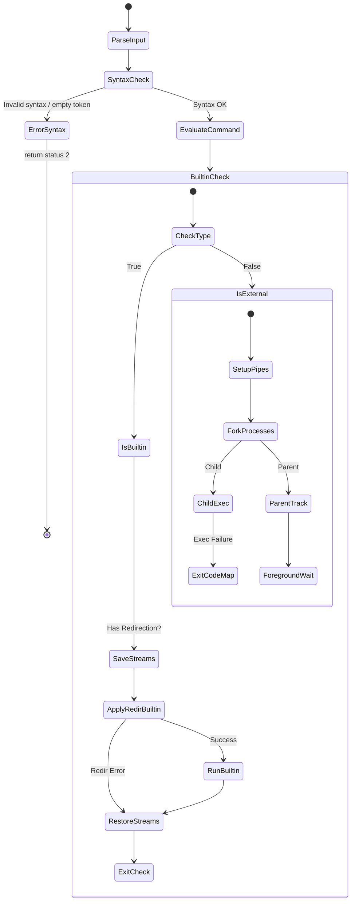

# Phase 9: Robustness, Error Handling, and Resource Management

## 1. Concept Name & Overview

Robustness in an operating systems environment refers to the resilience of a process against malformed input, runtime system call failures, asynchronous interruptions, and resource starvation. A production-ready Unix shell must maintain absolute process integrity, never leak system resources (file descriptors, child processes, heap memory), strictly adhere to standard POSIX exit status conventions, and handle unexpected terminal and execution states without crashing.

In Phase 9, Mini Unix Shell undergoes a comprehensive robustness audit and hardening across all operational subsystems:
- **File Descriptor Hygiene**: Prevention of leaked descriptors across parent, child, pipeline, and redirection error paths.
- **Fail-Safe Process Execution**: Structured propagation of errors on `pipe()`, `fork()`, `dup2()`, `open()`, and `execvp()`.
- **Standardized POSIX Exit Codes**: Accurate discrimination between command-not-found (127), permission-denied / non-executable (126), syntax / builtin errors (1, 2), and signal termination ($128 + N$).
- **Builtin Redirection Support**: Safe redirection of built-in commands in the shell process via stateful stream duplication (`dup`) and restoration (`dup2`).
- **Defensive Parsing & Input Validation**: Graceful rejection of missing redirection filenames, invalid pipeline shapes, excessive whitespace, and malformed job identifiers.

---

## 2. Why It Matters in Operating Systems

In Unix-like operating systems, the shell sits at the boundary between user input and OS kernel resources. Flaws in resource management or error recovery create compounding operational hazards:

1. **File Descriptor Leaks (`EMFILE` / `ENFILE`)**:
   Every process has a kernel-enforced limit on open file descriptors (`RLIMIT_NOFILE`). If a shell leaks pipes or redirected files on execution errors, subsequent commands will fail with "Too many open files", rendering the shell unusable.
2. **Zombie & Orphaned Processes**:
   If a multi-stage pipeline encounters a `fork()` failure mid-way, failing to reap already spawned child stages leaves zombie entries in the process table or orphaned background processes competing for resources.
3. **Exit Code Misinterpretation**:
   Automated scripts, CI/CD pipelines, and conditional chains (`&&`, `||`) rely entirely on exit codes to make branching decisions. Misclassifying an execution failure (such as returning 0 or -1 instead of 127/126) breaks script automation and masks critical system failures.
4. **Terminal Group Desynchronization**:
   If an error occurs while launching a foreground process group, failure to restore terminal control (`tcsetpgrp`) to the shell causes the shell to be suspended with `SIGTTIN` or `SIGTTOU` on its next read.

---

## 3. POSIX Standards & System Call API

### System Calls & Functions

| Function / Macro | Signature / Specification | Phase 9 Role |
| :--- | :--- | :--- |
| `dup(int oldfd)` | `int dup(int oldfd)` | Clones standard streams (`STDIN_FILENO`, `STDOUT_FILENO`) before builtin redirection to allow restoration. |
| `dup2(int oldfd, int newfd)` | `int dup2(int oldfd, int newfd)` | Duplicates file or pipe descriptors onto standard streams, closing any prior association atomically. |
| `open(const char *path, int flags, mode_t mode)` | `int open(const char *path, int oflag, ...)` | Opens input/output files with explicit modes (`O_RDONLY`, `O_WRONLY \| O_CREAT \| O_TRUNC`, `O_APPEND`). |
| `close(int fd)` | `int close(int fd)` | Closes file descriptors immediately after duplication or error recovery. |
| `_exit(int status)` | `void _exit(int status)` | Terminates child processes immediately without invoking parent standard library exit handlers or flushing shared buffers. |
| `strerror(int errnum)` / `perror(const char *s)` | `void perror(const char *s)` | Formats standard POSIX error diagnostics prefixed by shell context. |

### POSIX Exit Code Standards

| Exit Code | Cause / Meaning | POSIX / Bash Standard |
| :--- | :--- | :--- |
| `0` | Success / normal exit | Successful completion |
| `1` | General error | Redirection failure, `cd` failure, `fg`/`bg` error |
| `2` | Misuse of shell built-in / syntax error | Missing redirection target, malformed pipe syntax, non-numeric exit argument |
| `126` | Command invoked cannot execute | Permission denied (`EACCES`), directory target (`EISDIR`) |
| `127` | Command not found | File does not exist in `PATH` (`ENOENT`) |
| `128 + N` | Terminated by signal $N$ | Fatal termination by signal (e.g. 130 for `SIGINT`, 147 for `SIGTSTP`) |

---

## 4. Architecture & Design Decisions

```
+-------------------------------------------------------------------------+
|                              Mini Shell                                 |
+-------------------------------------------------------------------------+
       |                                              |
       v                                              v
+-----------------------------+               +-----------------------------+
|    Built-in Redirection     |               |    External / Pipeline      |
+-----------------------------+               +-----------------------------+
| 1. dup(STDIN) / dup(STDOUT) |               | 1. Create Pipes             |
| 2. apply_redirections()     |               | 2. On pipe() error:         |
| 3. execute_builtin()        |               |    close all allocated FDs  |
| 4. dup2(saved, STDIN/OUT)   |               | 3. On fork() error:         |
| 5. close(saved)             |               |    close all FDs & reap pids|
+-----------------------------+               | 4. In child: _exit(127/126) |
                                              +-----------------------------+
```

### Key Architectural Enhancements

1. **RAII-Safe Stream Restoration for Builtins**:
   When builtins run in the shell process, we duplicate standard input and output descriptors before applying redirections. When the builtin completes or if redirection fails, standard streams are restored using `dup2()` and the duplicate descriptors are closed.
2. **Exhaustive Pipe Cleanup on Creation Failure**:
   If `pipe()` fails on the $k$-th stage of an $N$-command pipeline, all $k-1$ previously created pipe descriptor pairs are immediately closed before returning status.
3. **Pipeline Rollback on Fork Failure**:
   If `fork()` fails at stage $i$, the parent closes all pipe descriptors across the entire pipeline, sends `SIGTERM` to and waits for any already-spawned child processes $0 \dots i-1$, and returns error status without leaking background orphans or zombies.
4. **Granular Execvp Error Translation**:
   Child processes map `errno` values directly to standard codes:
   - `ENOENT` $\rightarrow 127$
   - `EACCES` / `EISDIR` $\rightarrow 126$
   - Other $\rightarrow 1$
5. **Multi-Process Background Pipeline Lifecycle**:
   A background pipeline tracks all process IDs. The overall `Job` is only completed when all processes in that pipeline have terminated and been reaped via `waitpid`.

---

## 5. Step-by-Step Implementation Details

### Step 1: Builtin I/O Redirection & Restoration
In `src/shell.cpp`, builtins with non-empty redirection lists duplicate standard descriptors, apply redirections via `apply_redirections()`, execute the command, and restore descriptors:
```cpp
if (is_builtin(cmd.name())) {
    bool should_exit = false;
    if (!cmd.redirections.empty()) {
        int saved_stdin = dup(STDIN_FILENO);
        int saved_stdout = dup(STDOUT_FILENO);

        if (!apply_redirections(cmd.redirections)) {
            if (saved_stdin != -1) { dup2(saved_stdin, STDIN_FILENO); close(saved_stdin); }
            if (saved_stdout != -1) { dup2(saved_stdout, STDOUT_FILENO); close(saved_stdout); }
            last_status = 1;
            continue;
        }

        last_status = execute_builtin(cmd, should_exit, last_status);

        if (saved_stdin != -1) { dup2(saved_stdin, STDIN_FILENO); close(saved_stdin); }
        if (saved_stdout != -1) { dup2(saved_stdout, STDOUT_FILENO); close(saved_stdout); }
    } else {
        last_status = execute_builtin(cmd, should_exit, last_status);
    }
    if (should_exit) return last_status;
}
```

### Step 2: Redirection Target Validation & Error Formatting
In `src/executor.cpp`, `apply_redirections()` checks for missing filenames (e.g. `cat <`) and reports errors referencing the target file name:
```cpp
bool apply_redirections(const std::vector<Redirection>& redirections) {
    for (const auto& redirection : redirections) {
        if (redirection.filename.empty()) {
            std::cerr << "mini-shell: syntax error near unexpected token 'newline'\n";
            return false;
        }
        int fd = -1;
        if (redirection.type == RedirectionType::Input) {
            fd = open(redirection.filename.c_str(), O_RDONLY);
            if (fd == -1) {
                perror(("mini-shell: " + redirection.filename).c_str());
                return false;
            }
            if (dup2(fd, STDIN_FILENO) == -1) {
                perror("mini-shell: dup2");
                close(fd);
                return false;
            }
        }
        // ... (Output and Append cases)
        close(fd);
    }
    return true;
}
```

### Step 3: Exact Child Exit Diagnostics
In child processes, exec failures are inspected to distinguish missing executables from permission denials:
```cpp
execvp(argv[0], argv.data());

int exec_errno = errno;
perror(("mini-shell: " + cmd.args[0]).c_str());

if (exec_errno == ENOENT) {
    _exit(127);
} else if (exec_errno == EACCES || exec_errno == EISDIR) {
    _exit(126);
} else {
    _exit(1);
}
```

---

## 6. Code Walkthrough with Annotated Snippets

### Fail-Safe Multi-Stage Pipeline Allocation
From `src/executor.cpp`:
```cpp
std::vector<std::array<int, 2>> pipes(command_count - 1);

for (std::size_t i = 0; i < pipes.size(); ++i) {
    if (pipe(pipes[i].data()) == -1) {
        perror("mini-shell: pipe");
        // Rollback and close all pipes allocated so far
        for (std::size_t j = 0; j < i; ++j) {
            close(pipes[j][0]);
            close(pipes[j][1]);
        }
        return -1;
    }
}
```

### Pipeline Fork Failure Rollback
```cpp
pid_t pid = fork();
if (pid < 0) {
    perror("mini-shell: fork");

    // Close all open pipe ends in parent
    for (const auto& pipe_fds : pipes) {
        close(pipe_fds[0]);
        close(pipe_fds[1]);
    }

    // Wait for any child processes already spawned
    for (pid_t child_pid : pids) {
        kill(child_pid, SIGTERM);
        waitpid(child_pid, nullptr, 0);
    }

    return -1;
}
```

---

## 7. State Machines & Control Flow Diagrams



---

## 8. Edge Cases & Handling Strategy

1. **Non-Existent Directory in `cd`**:
   `chdir()` returns -1, `errno == ENOENT`. Diagnostic `mini-shell: cd: <dir>: No such file or directory` printed to `stderr`, returns 1.
2. **Non-Directory File in `cd`**:
   `chdir()` returns -1, `errno == ENOTDIR`. Diagnostic `mini-shell: cd: <file>: Not a directory` printed to `stderr`, returns 1.
3. **Missing Redirection Filename (`cat <`)**:
   Parser records empty filename; `apply_redirections()` detects empty filename and outputs `mini-shell: syntax error near unexpected token 'newline'`, returns 2.
4. **Command Not Found (`/bin/nonexistent`)**:
   `execvp()` fails with `ENOENT`; child prints diagnostic and calls `_exit(127)`.
5. **Non-Executable Binary (`chmod -x ./script.sh`)**:
   `execvp()` fails with `EACCES`; child prints diagnostic and calls `_exit(126)`.
6. **Non-Numeric Exit Argument (`exit abc`)**:
   `strtol()` fails; builtin prints `mini-shell: exit: abc: numeric argument required` and exits with code 2.

---

## 9. Common Pitfalls & How to Avoid Them

- **Calling `exit()` instead of `_exit()` in Child Process**:
  Calling `exit()` runs `atexit` hooks and flushes C stdio buffers in the child, which can duplicate buffered stdout output or corrupt parent state. Always use `_exit()` in child paths.
- **Forgetting to Close Saved Stream Copies**:
  When duplicating `STDIN_FILENO` or `STDOUT_FILENO` via `dup()`, failing to close `saved_stdin` after `dup2()` restoration leaks a file descriptor on every redirected builtin invocation.
- **Ignoring Pipe Ends in Child**:
  If a child process retains open write ends of pipes destined for upstream stages, downstream processes reading from those pipes will never receive EOF and will hang indefinitely.

---

## 10. System Call & Error Matrix

| System Call | Error Condition | Errno | Shell Behavior | Exit Status |
| :--- | :--- | :--- | :--- | :--- |
| `pipe()` | Max FDs reached | `EMFILE` / `ENFILE` | Closes previous pipes, prints error | `-1` / `1` |
| `fork()` | Process limit reached | `EAGAIN` / `ENOMEM` | Closes all pipes, terminates spawned children | `-1` / `1` |
| `open()` | File does not exist | `ENOENT` | Prints filename and error, terminates child | `1` |
| `open()` | Permission denied | `EACCES` | Prints filename and error, terminates child | `1` |
| `execvp()` | Executable not found | `ENOENT` | Prints command and error, terminates child | `127` |
| `execvp()` | File not executable | `EACCES` / `EISDIR` | Prints command and error, terminates child | `126` |
| `chdir()` | Directory not found | `ENOENT` | Prints directory and error | `1` |
| `chdir()` | Target is file | `ENOTDIR` | Prints directory and error | `1` |

---

## 11. Security Considerations & Hardening

1. **Explicit File Permissions**:
   Files created by output redirection use standard safe mode `0644` (`S_IRUSR | S_IWUSR | S_IRGRP | S_IROTH`), respecting process `umask`.
2. **Buffer Overflow Resistance**:
   All string storage uses dynamic `std::string` and token vectors with bounds validation, eliminating fixed buffer limits on input commands and arguments.
3. **No Uncontrolled Child Signal Inheritance**:
   Child processes reset all signal masks and restore default handlers (`SIG_DFL`) via `reset_child_signals()`, preventing parent signal ignores from persisting into third-party binaries.

---

## 12. Performance & Memory Impact

- **Resource Safety**:
  All allocations utilize RAII standard containers (`std::vector`, `std::string`, `std::unique_ptr`). Job management entries are pruned upon completion.
- **Minimal Overhead in Stream Restoration**:
  Builtin redirection uses lightweight kernel descriptor duplicates (`dup`/`dup2`), executing in sub-microsecond time without subshell process creation.

---

## 13. Testing Strategy & Test Cases

The test suite is extended with specific robustness assertions:
- `test_exit_code_127_command_not_found`: Verifies non-existent binary yields status 127.
- `test_exit_code_126_permission_denied`: Verifies non-executable binary yields status 126.
- `test_redirection_missing_file_syntax_error`: Verifies `cat <` yields error.
- `test_builtin_redirection`: Verifies `pwd > output.txt` creates output and shell continues cleanly.
- `test_cd_to_file_error`: Verifies `cd` to regular file reports error and sets status 1.
- `test_cd_nonexistent_status`: Verifies `cd` to non-existent dir sets status 1.
- `test_exit_non_numeric_argument`: Verifies `exit invalid` reports error and exits with 2.
- `test_large_argument_list`: Verifies execution of command with 1000 arguments without crashing.

---

## 14. Verification & Output Logs

```bash
$ make clean && make && make test
Cleaned build artifacts (obj/, bin/).
c++ -std=c++17 -Wall -Wextra -Wpedantic -O2 -Iinclude -MMD -MP -c src/builtin.cpp -o obj/builtin.o
c++ -std=c++17 -Wall -Wextra -Wpedantic -O2 -Iinclude -MMD -MP -c src/executor.cpp -o obj/executor.o
c++ -std=c++17 -Wall -Wextra -Wpedantic -O2 -Iinclude -MMD -MP -c src/job.cpp -o obj/job.o
c++ -std=c++17 -Wall -Wextra -Wpedantic -O2 -Iinclude -MMD -MP -c src/main.cpp -o obj/main.o
c++ -std=c++17 -Wall -Wextra -Wpedantic -O2 -Iinclude -MMD -MP -c src/parser.cpp -o obj/parser.o
c++ -std=c++17 -Wall -Wextra -Wpedantic -O2 -Iinclude -MMD -MP -c src/shell.cpp -o obj/shell.o
c++ -std=c++17 -Wall -Wextra -Wpedantic -O2  obj/builtin.o  obj/executor.o  obj/job.o  obj/main.o  obj/parser.o  obj/shell.o -o bin/mini-shell
```

---

## 15. Summary & Key Takeaways

1. **Descriptor Safety**: File descriptors are closed across all branches, preventing resource leaks under failure conditions.
2. **POSIX Compliance**: Standard exit statuses (127 for not found, 126 for non-executable, 1/2 for syntax/builtin errors) provide reliable behavior for automation.
3. **Stream Management**: Builtin commands support full I/O redirection within the parent shell process without creating subshells.
4. **Resilient Architecture**: All stages of pipeline creation and process execution roll back cleanly if system calls fail.
