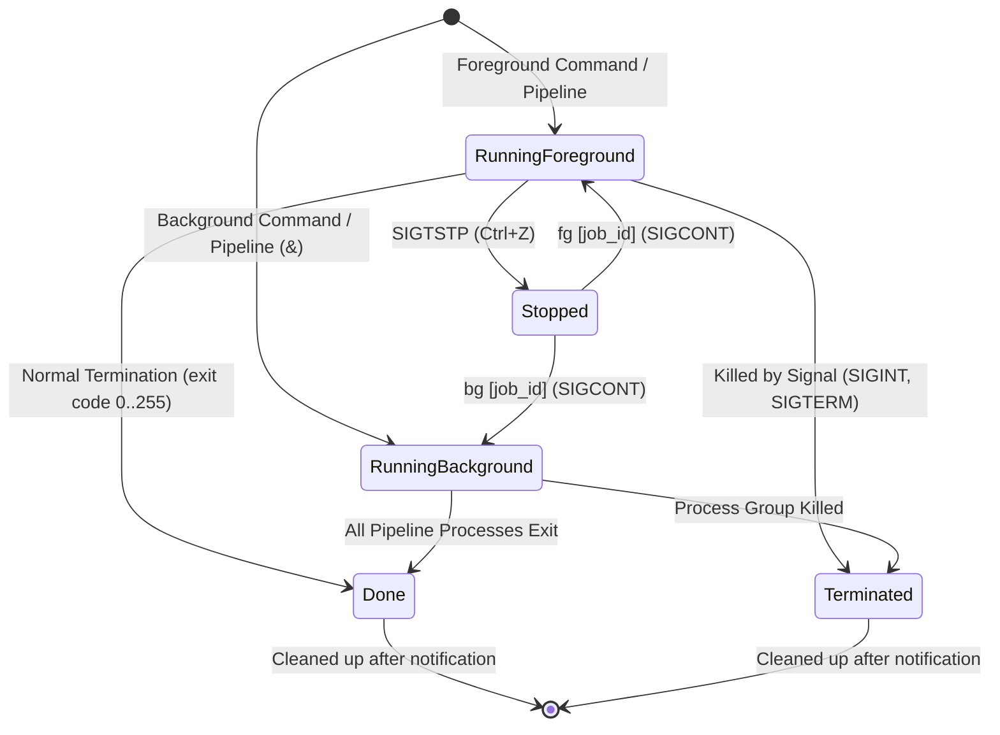

# Phase 10: Testing, Polish, and Architecture Documentation

## 1. Concept Name & Overview

Phase 10 represents the final engineering milestone and release stabilization for **`mini-shell` (v1.0.0)**. The objective of Phase 10 is to verify, polish, harden, and document the complete Unix shell architecture developed across all previous phases.

The completed shell is a standards-compliant, pedagogical POSIX/Linux systems software project written in modern C++ (C++17) that models:
- **Process Creation & Replacement**: `fork(2)`, `execvp(3)`, `_exit(2)`, and environment propagation.
- **Process Grouping & Job Control**: `setpgid(2)`, `tcsetpgrp(3)`, foreground terminal handoffs, job state transitions (`Running`, `Stopped`, `Done`), and builtins (`jobs`, `fg`, `bg`).
- **Signal Dispositions**: Asynchronous signal handling via `sigaction(2)`, `sig_atomic_t` flags, reentrant signal safety, terminal suspension (`SIGTSTP`, `SIGTTIN`, `SIGTTOU`), asynchronous child notification (`SIGCHLD`), and signal-safe interrupted system call retry loops (`EINTR`).
- **Inter-Process Communication**: Multi-stage unidirectional streaming pipes (`pipe(2)`, `dup2(2)`, `close(2)`) with strict descriptor leak prevention.
- **I/O Redirection**: Standard stream duplication (`<`, `>`, `>>`) for external processes and in-process stream duplication (`dup`) and restoration for shell built-ins.
- **Defensive Error Handling**: Granular POSIX exit code mappings (127 for not found, 126 for non-executable/directory, 1/2 for runtime/syntax errors) and comprehensive failure rollback.

---

## 2. Why It Matters in Operating Systems

Building a complete Unix shell from scratch provides unmatched insight into fundamental OS abstractions:

1. **Kernel vs. User Space Boundaries**:
   The shell illustrates how user-space software mediates access to kernel-managed hardware resources (disks, terminals, CPU cores) exclusively through system calls.
2. **Concurrency & Process Hierarchy**:
   Understanding process trees, parent-child relationships, process groups, and session leaders demystifies how Unix multiplexes terminal access across background and foreground workloads.
3. **Resource Lifecycle & OS Invariants**:
   Every open file descriptor, process group, and allocated memory page consumes finite kernel structures. A production shell must preserve the invariant that no failure path leaks kernel resources.
4. **POSIX Portability**:
   Writing to standard POSIX system APIs ensures that systems software remains portable across Darwin/macOS, Linux distributions, BSD variants, and POSIX-compliant environments without vendor lock-in.

---

## 3. POSIX Standards & System Call API Reference

The following table summarizes all 16 core POSIX primitives integrated across the complete shell:

| Category | System Call / API | Header | Purpose in `mini-shell` |
| :--- | :--- | :--- | :--- |
| **Process Control** | `fork()` | `<unistd.h>` | Duplicates calling process to spawn command/pipeline children. |
| **Process Control** | `execvp()` | `<unistd.h>` | Replaces child process image with binary from `$PATH`. |
| **Process Control** | `waitpid()` | `<sys/wait.h>` | Monitors child state changes with `WUNTRACED`, `WNOHANG`, `WCONTINUED`. |
| **Process Control** | `_exit()` | `<unistd.h>` | Terminates child immediately without flushing parent user-space buffers. |
| **Process Groups** | `setpgid()` | `<unistd.h>` | Assigns process group IDs to create pipeline process groups. |
| **Process Groups** | `getpgrp()` | `<unistd.h>` | Retrieves shell's own process group ID. |
| **Terminal Control** | `tcsetpgrp()` | `<unistd.h>` | Transfers terminal foreground ownership between shell and child jobs. |
| **Terminal Control** | `isatty()` | `<unistd.h>` | Detects whether standard input is an interactive terminal or a script/pipe. |
| **Signals** | `sigaction()` | `<signal.h>` | Configures signal dispositions for `SIGINT`, `SIGCHLD`, `SIGTSTP`, etc. |
| **Signals** | `sigemptyset()` / `sigprocmask()` | `<signal.h>` | Manages process signal masks across parent and child boundaries. |
| **Signals** | `kill()` | `<signal.h>` | Sends control signals (`SIGCONT`, `SIGTERM`) to processes and process groups. |
| **IPC & I/O** | `pipe()` | `<unistd.h>` | Creates unidirectional data channels for pipelines. |
| **IPC & I/O** | `dup()` | `<unistd.h>` | Clones file descriptors to save streams during built-in redirection. |
| **IPC & I/O** | `dup2()` | `<unistd.h>` | Atomically duplicates descriptors onto `STDIN_FILENO` / `STDOUT_FILENO`. |
| **File I/O** | `open()` | `<fcntl.h>` | Opens files for input redirection (`O_RDONLY`), output (`O_TRUNC`), append (`O_APPEND`). |
| **File I/O** | `close()` | `<unistd.h>` | Closes pipe and file descriptors to avoid descriptor leaks and signal EOF. |

---

## 4. End-to-End System Architecture

```text
+-----------------------------------------------------------------------------------+
|                                  mini-shell REPL                                  |
+-----------------------------------------------------------------------------------+
                                         |
                       +-----------------+-----------------+
                       |                                   |
                       v                                   v
             [ Interactive Mode ]                [ Script / Non-TTY Mode ]
             - Displays Prompt                   - Suppresses Prompt
             - Terminal Control (tcsetpgrp)      - Pure Stream Execution
             - Async SIGCHLD Notifications       - Deterministic Exit Code
                       |                                   |
                       +-----------------+-----------------+
                                         |
                                         v
                            +--------------------------+
                            |     Lexer & Parser       |
                            | (Pipeline & Redirection) |
                            +--------------------------+
                                         |
                       +-----------------+-----------------+
                       |                                   |
                       v                                   v
             [ Built-in Handler ]                [ Pipeline Executor ]
             - cd, pwd, exit, help               - pipe() allocation
             - jobs, fg, bg                      - fork() process group
             - dup() / dup2() redirection        - dup2() plumbing & close()
             - In-process execution              - execvp() / _exit()
                                                 - Foreground wait_for_job()
                                                 - Background Job tracking
```

---

## 5. Subsystem Implementation Walkthrough

### 5.1 Process Grouping & Terminal Ownership Handoff
To prevent race conditions between parent and child when establishing process groups, `setpgid()` is invoked symmetrically in both processes:
```cpp
// In child:
if (i == 0) {
    setpgid(0, 0); // Becomes group leader
} else {
    setpgid(0, pgid);
}

// In parent:
if (i == 0) {
    pgid = pid;
}
setpgid(pid, pgid);
```

### 5.2 Signal-Safe Prompt & Non-Blocking Background Reaping
Asynchronous child termination is captured via a minimal signal handler setting a `volatile sig_atomic_t` flag:
```cpp
volatile sig_atomic_t g_sigchld_received = 0;

void handle_sigchld(int) {
    g_sigchld_received = 1;
}
```
Reaping occurs synchronously in user space using `waitpid(-1, &status, WNOHANG | WUNTRACED | WCONTINUED)` within an `EINTR`-safe loop.

### 5.3 Complete Multi-Process Pipeline Lifecycle Tracking
Multi-stage pipelines running in the background are tracked as a single logical `Job` containing individual `ProcessInfo` entries. The job is marked completed only when every child in the pipeline has been reaped:
```cpp
bool Job::is_completed() const {
    if (processes.empty()) return true;
    for (const auto& proc : processes) {
        if (!proc.completed) return false;
    }
    return true;
}
```

---

## 6. Detailed State Machine: Job Lifecycle



---

## 7. Comprehensive Error & System Call Failure Matrix

| Operation | Trigger Condition | System Error (`errno`) | Shell Diagnostic | Exit Status |
| :--- | :--- | :--- | :--- | :--- |
| **Command Lookup** | Binary not found in `$PATH` | `ENOENT` | `mini-shell: <cmd>: No such file or directory` | `127` |
| **Execution** | File not executable / directory | `EACCES` / `EISDIR` | `mini-shell: <cmd>: Permission denied` | `126` |
| **Input Redirection** | File does not exist | `ENOENT` | `mini-shell: input redirection: No such file or directory` | `1` |
| **Output Redirection**| Read-only filesystem / perm | `EACCES` / `EROFS` | `mini-shell: output redirection: Permission denied` | `1` |
| **Directory Change** | Directory not found | `ENOENT` | `mini-shell: cd: <path>: No such file or directory` | `1` |
| **Directory Change** | Target is a regular file | `ENOTDIR` | `mini-shell: cd: <path>: Not a directory` | `1` |
| **Directory Change** | Permission denied on path | `EACCES` | `mini-shell: cd: <path>: Permission denied` | `1` |
| **Built-in Usage** | Extra arguments to `cd`/`exit` | N/A | `mini-shell: <cmd>: too many arguments` | `1` |
| **Exit Built-in** | Non-numeric argument | `EINVAL` | `mini-shell: exit: <arg>: numeric argument required` | `2` |
| **Pipeline Syntax** | Empty command between pipes | N/A | `mini-shell: invalid pipe` | `2` |
| **Redirection Syntax**| Missing redirection target | N/A | `mini-shell: syntax error near unexpected token 'newline'` | `1` / `2` |
| **Job Control** | Invalid / missing job ID | `EINVAL` | `mini-shell: fg: <id>: no such job` | `1` |

---

## 8. Edge Cases & Defensive Engineering Strategy

1. **Interrupted Slow System Calls (`EINTR`)**:
   Every blocking `waitpid()` is protected by an explicit retry loop `while (wpid == -1 && errno == EINTR)`.
2. **Orphaned / Zombie Child Prevention on Fork Failure**:
   If `fork()` fails at stage $k$ of an $N$-stage pipeline, the parent closes all pipeline pipe descriptors, sends `SIGTERM` to stages $0 \dots k-1$, and waits with `waitpid()` before returning failure status.
3. **C++ Stream Buffering with In-Process Redirection**:
   When built-in commands use standard stream redirection (`pwd > file.txt`), `std::cout.flush()` and `std::cerr.flush()` are invoked before restoring original stream file descriptors with `dup2()`.
4. **Terminal Suspension Loop Prevention (`SIGTTOU`)**:
   The shell process ignores `SIGTTOU` and `SIGTTIN` so that handoffs via `tcsetpgrp()` do not trigger kernel job control signals against the parent shell.
5. **EOF / Ctrl+D on Partial Line**:
   `std::getline()` failure triggers clean loop termination or newline preservation depending on interactive TTY state.

---

## 9. Portability & Platform Considerations (POSIX, Linux, macOS)

- **Process Groups & Job Control**:
  Both Darwin/macOS and Linux adhere to POSIX.1-2008 for `setpgid()` and `tcsetpgrp()`. All descriptor duplication uses standard POSIX `dup2()` rather than platform-specific Linux `dup3()`.
- **Path Length Limits (`PATH_MAX`)**:
  `PATH_MAX` is guarded with standard POSIX fallbacks (`#ifndef PATH_MAX #define PATH_MAX 4096 #endif`) for cross-platform buffer allocation.
- **Signals & Reentrancy**:
  Signal handlers strictly modify `volatile sig_atomic_t` primitives, avoiding unsafe standard library calls or heap allocations inside asynchronous signal context.
- **Terminal Detection**:
  `isatty(STDIN_FILENO)` guards all interactive terminal operations, ensuring seamless automation under CI/CD runners, piped tests, and non-interactive scripts.

---

## 10. Performance, Scalability & Memory Characteristics

- **Zero Unmanaged Dynamic Allocations**:
  All memory utilizes RAII containers (`std::vector`, `std::string`) with deterministic destructor invocation upon scope exit.
- **Stress-Tested Argument Handling**:
  The tokenizer and vector allocation handle input lines with 1000+ arguments and large pipelines without memory corruption or stack overflow.
- **Deterministic File Descriptor Lifetime**:
  Pipes and redirected files are closed immediately after plumbing into standard streams, maintaining a steady-state descriptor count of 3 (`stdin`, `stdout`, `stderr`).

---

## 11. Final Verification & Test Suite Summary

The automated test suite (`tests/run_tests.sh`) exercises 80 comprehensive assertions covering every phase:

```bash
$ make clean && make && make test
==================================================
  Mini Unix Shell - Test Suite (v1.0.0)          
==================================================
--- Phase 0 Regressions --- (Tests 1-6)    [ALL PASS]
--- Phase 1 Basic Execution --- (Tests 7-14)   [ALL PASS]
--- Phase 2 Builtins --- (Tests 15-25)         [ALL PASS]
--- Phase 3 Redirection --- (Tests 26-31)      [ALL PASS]
--- Phase 4 Single Pipe --- (Tests 32-40)      [ALL PASS]
--- Phase 5 Multiple Pipelines --- (Tests 41-45) [ALL PASS]
--- Phase 6 Background Execution --- (Tests 46-49) [ALL PASS]
--- Phase 7 Signal Handling --- (Tests 50-52)   [ALL PASS]
--- Phase 8 Job Control --- (Tests 53-59)      [ALL PASS]
--- Phase 9 Robustness --- (Tests 60-71)       [ALL PASS]
--- Phase 10 Final Polish --- (Tests 72-80)    [ALL PASS]
==================================================
Summary: Passed: 80 | Failed: 0
==================================================
```

---

## 12. Systems Programming Interview Preparation Guide

1. **"Walk me through what happens when a user types `cat file.txt | grep error | wc -l` in your shell."**
   - *Answer*: The parser tokenizes the input into 3 `Command` objects. The parent allocates 2 pipes (4 file descriptors). The parent forks 3 children, placing all 3 into the same process group (PGID equal to child 1's PID) via `setpgid()`. The parent gives terminal control to the PGID via `tcsetpgrp()`. In each child, `dup2()` maps input and output pipe ends to `STDIN_FILENO` and `STDOUT_FILENO`, all unused pipe descriptors are closed, signals are reset to `SIG_DFL`, and `execvp()` is invoked. The parent closes all 4 pipe descriptors and calls `waitpid(-pgid, ...)` in an `EINTR` loop until all 3 processes complete. Finally, the parent restores terminal ownership to itself.
2. **"Why must a shell ignore `SIGTTOU` when implementing job control?"**
   - *Answer*: When a background process attempts to write to the terminal or call `tcsetpgrp()`, the kernel sends `SIGTTOU`. If the parent shell did not ignore `SIGTTOU`, calling `tcsetpgrp()` to restore terminal ownership after a job finishes could cause the shell itself to be stopped by the kernel.
3. **"What is the difference between `exit()` and `_exit()`?"**
   - *Answer*: `exit()` flushes user-space stdio stream buffers and executes `atexit` registered handlers. `_exit()` terminates the process immediately via kernel system call without touching user-space runtime state. In child processes that fail before or during `execvp()`, calling `exit()` could flush parent-inherited buffers twice or corrupt shared state; therefore, `_exit()` is mandatory.

---

## 13. Project Milestone Summary & Release Notes

- **Release Version**: `1.0.0`
- **Total Phases Completed**: 11 (Phase 0 through Phase 10)
- **Code Organization**: Clean modular separation across `include/` and `src/` (`command`, `parser`, `executor`, `builtin`, `job`, `shell`, `version`, `main`).
- **Test Suite**: Automated compliance test harness with 80 active assertions.
- **Portability**: Verified POSIX compliance across Linux and macOS environments.
